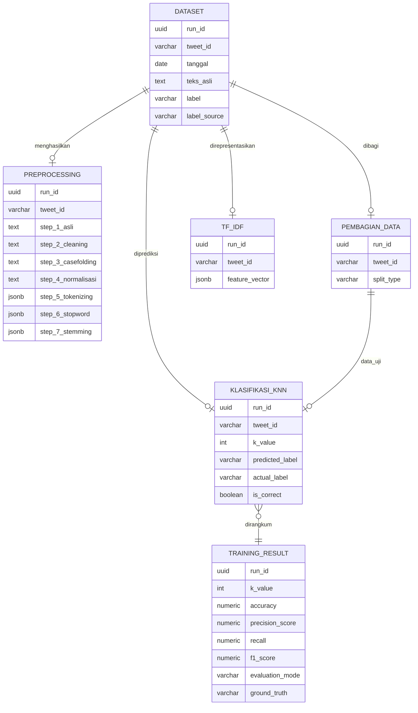

# ERD Database SentiKNN

Dokumen ini memakai nama konseptual Bahasa Indonesia untuk laporan. Nama tabel fisik tidak diubah agar tetap sesuai dengan aplikasi dan migrasi yang telah dipakai.

| Nama konseptual | Tabel fisik | Identitas data |
|---|---|---|
| Dataset | `tweets` | `run_id`, `tweet_id` |
| Preprocessing | `preprocessing_results` | `run_id`, `tweet_id` |
| PembagianData | `split_data` | `run_id`, `tweet_id` |
| TF-IDF | `tfidf_matrix` | `run_id`, `tweet_id` |
| KlasifikasiKNN | `knn_results` | `run_id`, `tweet_id` |
| TrainingResult | `evaluation_metrics` | `run_id` |

`label_source` bernilai `manual` untuk label pakar dan `lexicon` untuk pseudo-label. `evaluation_mode` bernilai `manual` atau `exploratory`; mode `exploratory` memakai `ground_truth = pseudo_label` dan tidak boleh disimpulkan sebagai evaluasi ground truth pakar.

`feature_vector` disimpan sebagai JSONB sparse agar database tidak menyimpan seluruh kombinasi dokumen dan term yang bernilai nol.
